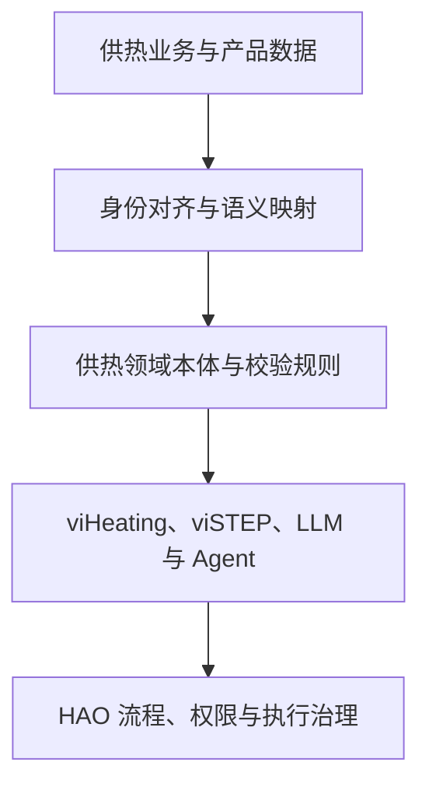

# 本体论系统学习与产品落地路线图 v0.1

## 1. 目标

系统学习工程本体论，并把它变成英集动力供热产品与 AI 体系共用的语义基础：让不同系统、数据、模型和 Agent 对“同一个对象、关系、状态和动作”有一致理解。

这项工作同时服务两个目标：

1. 建立一套可持续学习、讨论和评审本体模型的方法。
2. 在供热产品中验证本体能否改善数据联通、运行分析、AI 问答与 Agent 执行。

本体不是单纯的术语表、数据库表结构或知识图谱。它先定义领域概念及其关系、约束和含义；知识图谱或其他存储用于承载实例数据，产品和 AI 再通过映射、查询与规则使用这些语义。

## 2. 放在现有 AI 架构中的位置

| 能力 | 要回答的问题 | 当前对应方向 |
|---|---|---|
| 领域本体 | 世界里有哪些对象，它们是什么关系？ | 供热/能源领域共享语义模型 |
| 数字孪生 | 这些对象现在处于什么状态？ | viHeating 与实时运行数据 |
| 时空演化模型 | 状态如何变化，未来可能怎样？ | STEPmodel 总体方法、viSTEP 供热实现 |
| 大语言模型 | 人用语言提出了什么意图，结果如何解释？ | LLM 能力 |
| Agent | 怎样查询、分析或调用工具完成任务？ | Agent 与 Agent Runtime |
| HAO | 人和多个 Agent 如何按组织、角色和流程协同？ | Human-Agent Organization |

因此，本体为 viHeating、viSTEP、LLM、Agent 和 HAO 提供共享的业务语义；它不替代物理机理模型、时序预测模型或工作流运行时。

## 3. 学习与建设方式

建议按 8 个学习单元推进，节奏可按每周一个单元安排。每个单元都要产出一项可评审成果，不把学习停留在概念阅读。

| 单元 | 学习主题 | 供热产品练习 | 产出 |
|---|---|---|---|
| 1 | 工程本体论是什么；与术语表、分类体系、数据模型、知识图谱的区别 | 选一个产品问题，列出涉及的对象、关系和判断 | 目标问题与边界说明 |
| 2 | 概念、类型、实例、属性、关系、状态、事件、身份、时间和空间 | 分辨“换热站”类型、某座站实例、站的运行状态和一条测点观测 | 供热概念词汇表 v0.1 |
| 3 | RDF、OWL、SHACL 与基本逻辑；开放世界假设及其工程影响 | 用少量示例表达“传感器观测供水温度”和数据约束 | 供热语义模型小样与校验规则 |
| 4 | 本体工程方法：范围、能力问题、概念复用、模块化、版本治理 | 为告警影响分析写出 10–20 个可验证问题 | 能力问题清单与模型范围 |
| 5 | 供热领域建模：资产、管网拓扑、测点、观测、告警、客户、工单、动作 | 建模热源、管段、换热站、楼宇、传感器、告警及其关系 | 供热领域本体 v0.1 |
| 6 | 数据语义映射：主数据身份、GIS、遥测、告警、单位、时间、来源与质量 | 将一小批现有产品数据映射到本体概念，并追溯源字段 | 数据映射表与样例数据集 |
| 7 | 产品与 AI 集成：查询、解释、检索、工具调用、授权和审计 | 让 LLM/Agent 基于对象关系回答告警影响范围，并提供依据 | 本体驱动的 AI 交互原型 |
| 8 | 评估、治理与演进：正确性、覆盖度、变更、兼容和责任 | 用真实场景复核模型与原型；记录未解决的问题 | 评估报告、治理规则与 v0.2 backlog |

## 4. 供热领域的第一个范围

初版先覆盖能贯通产品与 AI 的一条业务切片，避免一开始试图建模全部供热知识：

- **对象**：热源、热网、管段、阀门、泵、换热站、楼宇/热用户、设备、传感器、测点、观测、告警、工单、运行策略。
- **关系**：连接、供热、服务、包含、安装于、监测、发生于、影响、由……处理、来源于。
- **公共语义**：对象唯一标识、名称与别名、空间位置、有效时间、数据来源、质量状态、单位、权限范围。
- **边界**：供热机理与控制算法保留在各自模型中；本体说明对象语义、依赖和约束，通过明确映射与这些模型协作。

一个重要区分：`Sensor_047` 是传感器实例，`SupplyWaterTemperature` 是被观测属性，`Observation_...` 是带有时间、数值、单位和来源的一条观测。把它们混成一个“测点字段”，会让跨产品解释、追溯和模型输入变得困难。

## 5. 推荐的首个产品试点

**告警影响范围追溯与解释**：从一条告警出发，沿“测点—设备/管段—换热站—热网—热用户”关系追溯影响对象，展示证据路径、数据来源和不确定项；再由 LLM 将结果组织成运维人员能读懂的解释。后续可把规范化后的对象与关系输入 viSTEP，提供状态建模所需的空间、拓扑和设备语义。

试点验收围绕能力问题清单展开：

1. 系统能否定位告警对应的测点与设备？
2. 能否沿真实拓扑找到上游/下游相关站点和用户？
3. 结果能否返回关系路径、来源记录和时间范围？
4. 数据缺失或关系冲突时，能否明确标出未知或冲突，而不是让 AI 补造事实？
5. 涉及写操作时，Agent 是否使用受约束的动作接口，并服从权限和审批流程？

## 6. 从学习成果到产品能力

实施时先保持概念模型与存储技术分离。验证出明确需求后，再决定哪些部分采用 RDF/OWL、哪些通过现有关系库、时序库、GIS 或图数据服务实现。标准应提供可复用语义与互操作方式，不要求把现有系统一次性推倒重来。

## 7. 需要重点掌握的标准和案例

### 基础标准

- [W3C RDF 1.1 Primer](https://www.w3.org/TR/rdf11-primer/)：用图和三元组表达实体及关系。
- [W3C OWL 2 Primer](https://www.w3.org/TR/owl2-primer/)：表达类型、属性、逻辑公理及推理。
- [W3C SHACL](https://www.w3.org/TR/shacl/)：对 RDF 数据图执行结构与约束校验。
- [W3C SSN/SOSA](https://www.w3.org/TR/vocab-ssn-2023/)：学习传感器、观测、采样和被观测对象的语义模式。
- [ETSI SAREF 设计原则](https://saref.etsi.org/principles.html)、[SAREF4ENER](https://saref.etsi.org/saref4ener/v2.1.1/) 和 [SAREF4BLDG](https://saref.etsi.org/saref4bldg/v2.1.1/)：考察智能应用、能源和建筑领域的概念复用与扩展方法。
- [Brick Schema 文档](https://docs.brickschema.org/)：参考楼宇 HVAC 设备与测点的语义建模；用于借鉴，不直接等同于城镇供热管网模型。

### 产品案例

- [Microsoft Fabric IQ Ontology](https://learn.microsoft.com/en-us/fabric/iq/ontology/overview)：观察企业语义、数据关系与 Copilot/Agent grounding 如何结合。官方文档当前标注为 Preview，重点学习产品组织方式，避免把预览功能当作稳定标准。
- [Palantir Foundry Ontology 概览](https://www.palantir.com/docs/foundry/ontology/overview)：研究其如何把数据源映射为对象、属性和关系，并把动作、函数、安全治理与业务应用连起来。

## 8. 评审原则与近期动作

每个概念都要有明确定义、边界、标识方式、来源和使用例子；每条关系都应说明方向、含义和适用条件。优先复用已有标准中的通用概念，对供热特有内容做小而清晰的扩展。模型变更要保留版本、映射影响和兼容策略。

**近期第一步**：选定“告警影响范围追溯”作为学习贯穿案例，整理 10–20 个能力问题，再从 viHeating 当前的数据对象、GIS 拓扑、告警和测点中挑选一组真实样例，形成领域词汇表和第一版关系图。完成这一步后，再决定是否要落成 OWL/RDF 实现及具体存储方案。
